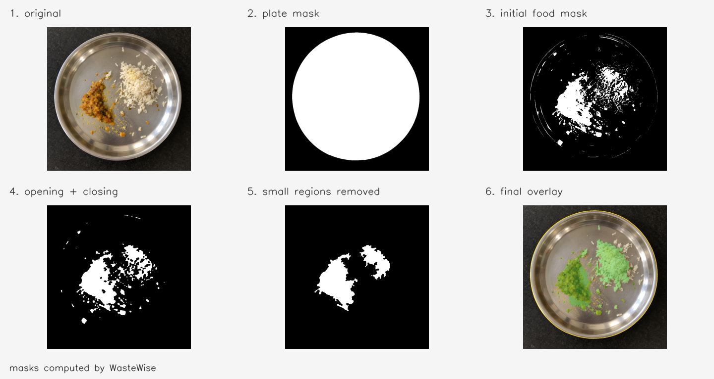

# WasteWise

A Raspberry Pi camera system that automatically logs food waste by type and estimated volume, viewable in a dashboard showing daily and weekly metrics. This repo contains the detector and the seven-class model deployed in the Udman hotel, Panchshila Park.
Testimonials from deployment partners can be found in the `/testimonials` folder.
You can see the sample version of the dashboard **[here](https://github.com/arjun-maker-portfolio/dashboard)**.



## Run

Use Python 3.11 or 3.12 in a virtual environment. From this folder:

```bash
python -m pip install -r requirements.txt
python scripts/app.py --check-model
python scripts/app.py --camera 0 --save-frames
```

The model check verifies loading and inference. Annotated images go to `output/`, records go to `data/utensil_sessions.json`. No display is needed. Stop with Ctrl+C.

For your own video:

```bash
python scripts/app.py --video clip.mp4 --interval 0.5 --save-frames --dry-run
```

`--dry-run` skips records but permits saved images. No video is bundled.

To reproduce the masking example using only OpenCV and NumPy:

```bash
python scripts/show_masks.py examples/food_plate.png --output output/masks
```

## Method and assumptions

Edges and steel-colour thresholds locate the plate. Rim-relative colour and texture cues, morphological cleanup, and optional GrabCut isolate food. The MobileNetV2-based classifier labels each disconnected patch. Matching labels are combined, and observations averaged within a plate session.

Use an overhead view of a round steel plate. Defaults are 280 mm diameter and 10 mm food depth; change them with `--plate-diameter-mm` and `--depth-mm`. Volume is area times assumed depth, not measured weight. Touching foods may merge.

## Storage, startup, tests

For Firestore, copy `.env.example` to `.env`, set the credentials path, and add `--use-firebase`. Local JSON also records failed cloud writes.

On a Pi, install dependencies in `venv` or `.venv`, then:

```bash
sudo bash setup_autostart.sh
sudo systemctl start foodwaste-detector
```

The installer uses your account and folder. Logs: `journalctl -u foodwaste-detector -f`.

```bash
python -m unittest discover -s tests -v
```

Tests cover accounting, sessions, and storage. Built with OpenCV, TensorFlow/Keras, and Firebase Admin SDK.
